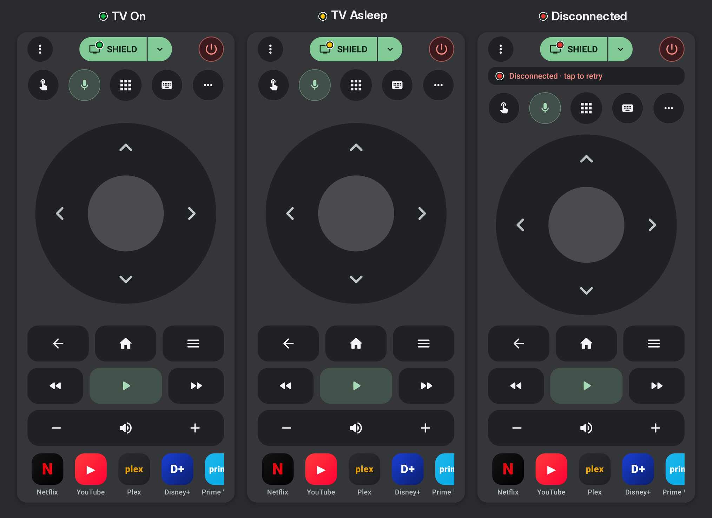
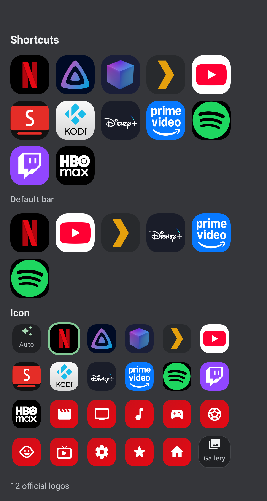

# Android TV Remote

A fast, reliable Android phone remote for **Android TV and Google TV** devices — NVIDIA Shield, Chromecast with Google TV, Sony Bravia, and many more.

It talks to the TV directly over the [Android TV Remote Protocol v2](https://github.com/tronikos/androidtvremote2), the same protocol the official Google TV remote uses, so nothing needs to be installed on the TV. Built as a replacement for the Google TV app's remote, which kept disconnecting.

<p align="center">
  
</p>
<p align="center">
  
</p>

The sideloaded app is shipped as `ShieldRemote.apk` (package `dev.krist.shieldremote`).

## Features

- **D-pad or touchpad** navigation, with haptic feedback
- **Back, Home, Menu, Recent apps**, plus long-press actions
- **Media controls**: play/pause, rewind and fast forward (hold to repeat)
- **Volume and mute** (hold to repeat). Volume numbers are hidden when the device reports 0, which happens if a TV or AVR controls volume over CEC.
- **Power button** in the top bar: tap to toggle, hold for Power / Sleep / Wake. If the device is asleep and the link is down, a tap reconnects and wakes it.
- **TV status** on the device pill: a colored dot on the TV icon shows **green** when the device is on, **yellow** when it is asleep, and **red** when it is off or disconnected.
- **Keyboard typing** straight into the focused text field on the TV
- **App shortcuts** with original app logos (Netflix, YouTube, Jellyfin, and more), generic icons, or a picture from your gallery
- **Stays connected**: a foreground service with automatic reconnect, and controls in the notification
- **Quick Settings tile** and a **home screen widget**
- **Multiple devices**: automatic discovery on the local network and per-device pairing
- Dark Material 3 design

> **Voice input** is not working yet — we're working on it, and for now it has been removed from the UI.

## Supported devices

Any device that runs **Android TV** or **Google TV** and speaks Android TV Remote Protocol v2. No extra app is required on the TV. In practice that includes:

**Streaming boxes and sticks**

- NVIDIA Shield TV and Shield TV Pro
- Google TV Streamer
- Chromecast with Google TV (HD and 4K)
- Onn 4K, 4K Pro, and other Onn Google TV models
- Xiaomi Mi Box, TV Box S, and TV Stick (Android TV / Google TV models)
- Nokia Streaming Box
- Strong Leap
- Mecool (Android TV / Google TV models)
- TiVo Stream 4K
- Formuler (Android TV models)

**Smart TVs** (models that actually run Android TV or Google TV)

- Sony Bravia
- TCL
- Hisense
- Philips
- Panasonic
- Sharp
- Xiaomi TV

If the official Google TV / Android TV remote app can pair with it, this app should be able to as well.

### Not supported

These platforms use a different remote protocol, so they will not pair:

- Samsung Tizen
- LG webOS
- Roku
- Apple TV
- Amazon Fire TV
- Hisense VIDAA (and other non-Android smart TV platforms)

## Install

1. Download the latest `ShieldRemote.apk` from [Releases](https://github.com/xTryhard8723/android-tv-remote/releases).
2. Open it on your phone (Android 8.0 or newer) and allow installing from unknown sources.
3. Open the app, pick your device (or enter its IP address), and type the pairing code shown on the TV.

Your phone and the TV need to be on the same network.

## Build from source

Requirements: JDK 17 and the Android SDK (compileSdk 35).

```bash
./gradlew assembleDebug
```

Release builds are signed with a keystore that isn't part of this repo. To build a signed release, create `keystore/signing.properties` with `storeFile`, `storePassword`, `keyAlias` and `keyPassword`, then run `./gradlew assembleRelease`.

## Project layout

| Path | What's there |
| --- | --- |
| `app/src/main/java/dev/krist/shieldremote/net` | Discovery (mDNS), TLS, pairing client (port 6467) and remote session (port 6466) |
| `app/src/main/java/dev/krist/shieldremote/proto` | Protobuf message encoding for pairing and remote messages |
| `app/src/main/java/dev/krist/shieldremote/protocol` | Pairing secret, reconnect logic, typing (IME), voice streaming |
| `app/src/main/java/dev/krist/shieldremote/service` | Foreground service, Quick Settings tile, widget |
| `app/src/main/java/dev/krist/shieldremote/ui` | Jetpack Compose screens and components |
| `tools/mocktv` | A Python mock TV for testing without real hardware |
| `tools/*.proto` | Protocol definitions |

## Testing

Unit and Robolectric screenshot tests run with:

```bash
./gradlew testDebugUnitTest
```

To test against a fake TV, run `python3 tools/mocktv/mocktv.py` (needs `pyOpenSSL` and `protobuf`) and point the app at that machine's IP address.

## Trademarks

App logos bundled with the shortcut picker (Netflix, YouTube, Disney+, and others) are trademarks of their respective owners. They are included only to identify those apps.

## Credits

The protocol work draws on [androidtvremote2](https://github.com/tronikos/androidtvremote2) as a reference.

## License

[MIT](LICENSE)
